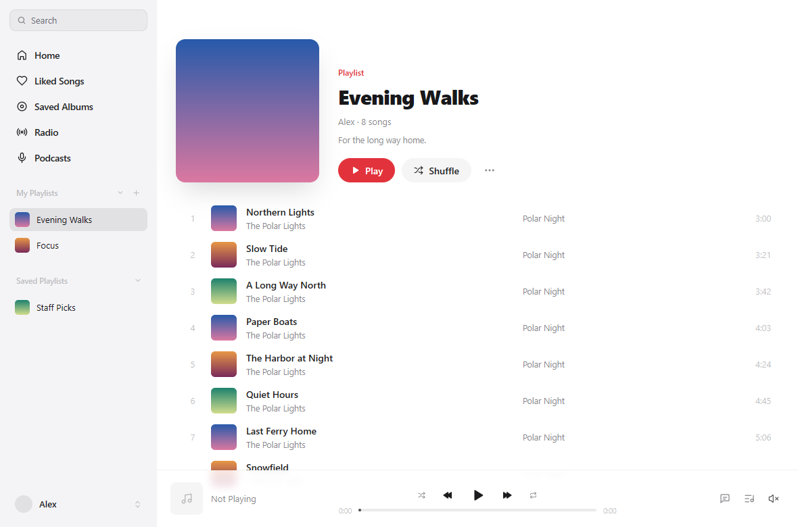
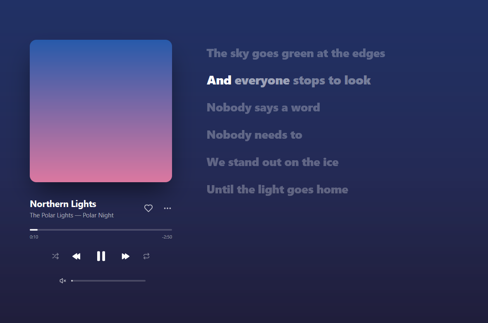
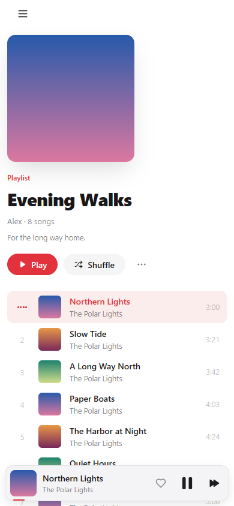
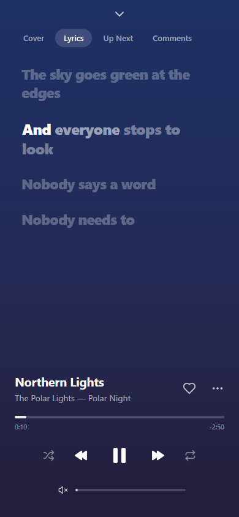
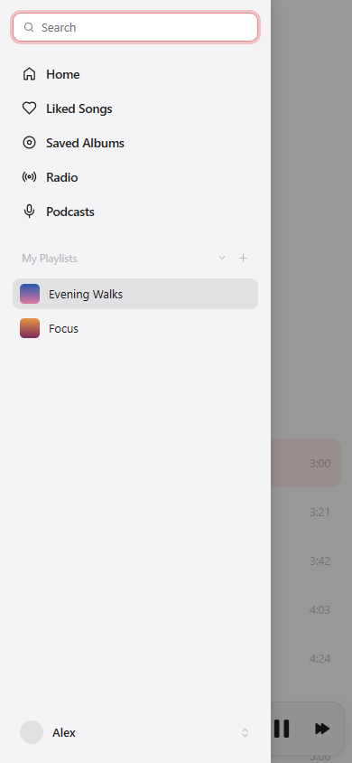

# MyGo Music Classic

> **这是老版 MyGo Music 的“补档”。**
>
> 早期的 MyGo Music 自带网易云音乐；后来它改成了“本地音乐 + 插件”的形态，网易云要靠第三方插件才能用。这个仓库把老版的体验补回来：网易云音乐重新内置进应用，打开即用，不需要装插件，也不需要另跑 API 服务。

一个用 Go 和 [MyGo](https://github.com/egoist/mygo) 写成的网易云音乐第三方客户端。界面由 MyGo 在 GPU 上原生绘制，没有 WebView、没有 Electron，也不带 JavaScript 引擎，一套代码跑在 Windows、macOS、Linux、Android 和 iOS 上。



| 正在播放 | 手机：歌单 | 手机：正在播放 | 手机：音乐库 |
| --- | --- | --- | --- |
|  |  |  |  |

## 功能

**网易云音乐**

- 扫码登录（网易云音乐 App 扫一扫），登录状态保存在本机
- 发现音乐：每日推荐、推荐歌单、新歌速递、推荐播客
- 私人 FM、私人雷达、排行榜、歌单广场（按分类浏览）、热门歌手
- 我喜欢的音乐、收藏的歌单与专辑、云盘、个人主页
- 搜索歌曲、专辑、歌手、歌单、播客，输入时给出搜索建议
- 歌单管理：新建、重命名、删除、收藏 / 取消收藏，添加和移除歌曲
- 喜欢歌曲、关注歌手、收藏专辑、订阅播客
- 歌曲评论：热评与最新评论，点赞，发表评论
- 歌词：逐字歌词（yrc）与翻译，没有逐字歌词时用普通 LRC
- 音质：标准、极高（320k）、无损（FLAC），在设置里切换

**播放器**

- 播放队列、随机、单曲 / 列表循环、断点续播（退出后再打开，队列和进度都在）
- “正在播放”页：歌词、舞台歌词、播放队列、封面墙、评论；黑胶 / 磁带播放器样式
- 间奏时显示热评，暂停与跳转时淡入淡出，按响度均衡音量
- 听过的歌缓存在本机，再听不耗流量（上限可调，默认 512 MB）
- 系统媒体键与系统媒体控制（Windows 音量浮窗、macOS 控制中心、Linux MPRIS）
- 托盘菜单；macOS 上还有刘海迷你播放器
- 同时可以播放本地音乐：MP3、FLAC、Ogg、WAV、M4A，连同标签、封面与 .lrc 歌词
- 浅色、深色、跟随系统；简体中文与英文界面
- 自动更新（桌面端）

**手机与窄窗口**

窗口宽度小于 720 时自动换成手机布局：资料库收进左侧抽屉，迷你播放条悬浮在页面底部，“正在播放”按封面、歌词、播放队列、评论分页显示。

## 资源占用

| | 大小 / 占用 | 说明 |
| --- | --- | --- |
| Windows 安装包 | 7.3 MB | 装好后是一个约 21 MB 的 exe，不依赖 WebView2 |
| Linux `.deb` / `.rpm` | 9.1 MB | 只依赖 GTK 3，不需要 WebKitGTK |
| Windows 内存（首页，含封面） | 约 150 MB 工作集 | 其中 Go 堆约 15–20 MB，其余是 Direct3D 与字体 |
| 画面静止时 | 不重绘、几乎不占 CPU | MyGo 只在有变化时绘制 |

和老版相比，补档版去掉了 JavaScript 插件引擎和播客语音识别：同样的构建，Windows 可执行文件从约 30 MB 降到约 22 MB，也不再为每个插件起一个 JavaScript 运行时。封面缓存上限降到 24 MB，Go 的垃圾回收也调得更积极。

## 下载

到 [Releases](https://github.com/VOfficial404/mygo-music-classic/releases/latest) 下载对应平台的文件：

| 平台 | 文件 |
| --- | --- |
| Windows | `mygo-music-classic-setup-<版本>-amd64.exe`（ARM 设备选 `arm64`） |
| macOS | `mygo-music-classic-<版本>-arm64.dmg`（Intel Mac 选 `amd64`） |
| Linux | `.deb`、`.rpm`，或带 `install.sh` 的 `.tar.gz` |
| Android | `mygo-music-classic-<版本>.apk` |
| iOS / iPadOS | `mygo-music-classic-<版本>.ipa` |

**macOS**：应用没有经过 Apple 公证，第一次打开会被拦下。把它拖进“应用程序”后，在终端执行一次：

```bash
xattr -dr com.apple.quarantine "/Applications/MyGo Music Classic.app"
```

**Windows**：安装包没有代码签名，SmartScreen 提示时点“更多信息 → 仍要运行”。

**Android**：需要 Android 8.0 及以上。允许“安装未知应用”后直接安装 apk。

**iOS**：`.ipa` 用自签名证书签过，用于自签安装：用 [AltStore](https://altstore.io)、[SideStore](https://sidestore.io)、Sideloadly 或 TrollStore 安装，它们会用你自己的 Apple ID 重新签名。

## 从源码构建

需要 [Go](https://go.dev/dl/) 1.27 或更高版本。桌面端不需要 cgo，任何系统都能交叉编译所有桌面平台。

```bash
go tool mygo dev                    # 开发运行，改代码自动重启
go tool mygo build                  # 打包当前平台到 build/
go tool mygo build -platform windows/amd64,linux/amd64,darwin/universal
go tool mygo build -platform android    # 需要 Android SDK 与 NDK
go tool mygo build -platform ios        # 需要装有 Xcode 的 Mac 和描述文件
go test ./internal/...
```

推送 `v*` 标签后，[`.github/workflows/release.yml`](.github/workflows/release.yml) 会在 GitHub Actions 上构建全部五个平台并发布到 Releases。

## 代码结构

| 目录 | 内容 |
| --- | --- |
| `internal/netease` | 网易云音乐：weapi / eapi 加密、扫码登录、Cookie 持久化，以及全部接口 |
| `internal/app` | 界面，包括手机布局（`ui_compact.go`） |
| `internal/player` | 播放、队列、缓存、淡入淡出、响度均衡 |
| `internal/local` | 本地音乐扫描 |
| `internal/lyrics` | LRC 与逐字歌词 |

## 致谢与许可

- 本项目基于 [EGOIST](https://github.com/egoist) 的 [MyGo Music](https://github.com/egoist/mygo-music) 和 [MyGo](https://github.com/egoist/mygo)，界面与播放器几乎都来自原作。
- 网易云接口的用法参考了 [NeteaseCloudMusicApi](https://github.com/Binaryify/NeteaseCloudMusicApi) 以及社区的 MyGo Music 网易云插件。
- 与原项目一样，以 [AGPL-3.0](LICENSE) 开源。

本项目是非官方的第三方客户端，与网易云音乐、网易公司无关。音乐内容的版权归各自权利人所有，请支持正版。
